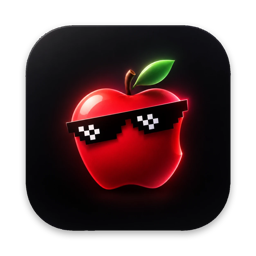
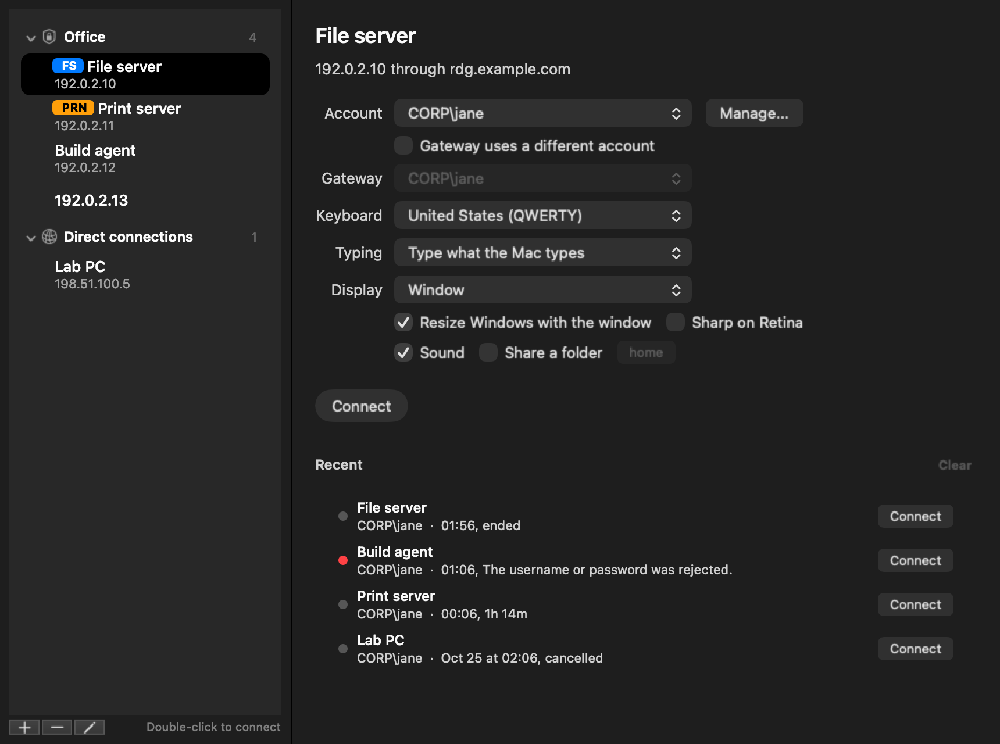

<p align="center"></p>

# iGateway.exe

A Remote Desktop client for the Mac, for Windows servers behind an RD Gateway
or reached directly. Built on [FreeRDP](https://github.com/FreeRDP/FreeRDP),
but it behaves like a Mac app.



## Features

- **Gateways.** Servers are grouped per RD Gateway, each with its own account.
  Servers without a gateway go under "Direct connections".
- **SSH too.** SSH hosts open in a terminal window of their own, through the
  Mac's own ssh: keys, certificates, jump hosts, and passwords saved in the
  Keychain if you want.
- **A Dock icon per server.** Every session is its own app, with the server's
  label on its icon in a colour you pick, so switching is one click.
- **Recent connections.** What you connected to, for how long, and why
  something failed.
- **Feels like a Mac.** Resize the window or go fullscreen and Windows follows.
  Cmd-C and Cmd-V, the Mac's scroll direction and your keyboard layout just
  work.
- **Copy and paste** text, images and files, both ways.
- **Safe by default.** Passwords go in the Keychain. A server certificate that
  neither FreeRDP nor macOS can verify is shown to you before you log in.
- Sound, a shared folder, and export and import of your server list (never
  passwords or accounts).

## Install

You build it yourself. It runs on an Apple Silicon Mac with macOS 13 or
later. No Homebrew needed.

1. Install the Xcode Command Line Tools, if you don't have them yet. They
   bring git and the compilers, and need the macOS 14 SDK or later.

   ```bash
   xcode-select --install
   ```

2. Get the code.

   ```bash
   git clone https://github.com/FarAbove420/igateway.git
   cd igateway
   ```

3. Build FreeRDP, OpenSSL, FFmpeg's H.264 decoder and SwiftTerm. This
   downloads them, checks each against a pinned SHA-256 and builds them into
   `deps/out`. It takes a few minutes and only has to run once.

   ```bash
   ./deps/build-deps.zsh
   ```

4. Build the app and install it.

   ```bash
   ./build.zsh --install
   ```

5. Open iGateway.exe from `~/Applications`, the Applications folder inside
   your home folder (not the main one).

### Update

Quit iGateway first, then in the `igateway` folder:

```bash
git pull
./deps/build-deps.zsh
./build.zsh --install
```

`build-deps.zsh` only rebuilds what changed.

## Your data

- Servers and settings: `~/Library/Application Support/iGateway/config.json`
- Passwords: your login Keychain, only when you choose to save them
- Logs: `~/Library/Logs/iGateway`, or Window, Show Logs. Never passwords.

To remove iGateway, delete the app, those two folders and
`~/Library/Caches/iGateway`. Saved passwords are in Keychain Access under
"iGateway.exe".

## Limits

- Logins use NTLM; Kerberos isn't supported.
- No smartcards, printers, microphone, USB devices or multiple monitors.
- H.264 video is decoded in software.
- SSH hosts can't go through an RD Gateway, which only carries Remote
  Desktop. Use a jump host instead.

## What's in here

- `swift/`: the app (window, host list, sessions, clipboard, keyboard)
- `bridge/`: a small C layer between the app and FreeRDP
- `deps/build-deps.zsh`: downloads and builds FreeRDP, OpenSSL, FFmpeg and SwiftTerm
- `build.zsh`: builds the app; `release.zsh`: packs it for a release
- `tests/`: the tests, run with `tests/run.zsh`
- `icon/`: the icons and the code that draws them
- `docs/`: how it works, and the images in this README
- `.github/workflows/`: builds and tests every push on GitHub

## More

- [How it works, and why](docs/how-it-works.md)
- Tests: `./tests/run.zsh`
- License: Apache 2.0. FreeRDP and OpenSSL are Apache 2.0 too, FFmpeg's
  decoder is LGPL 2.1 or later, SwiftTerm is MIT. See
  [THIRD_PARTY_NOTICES.md](THIRD_PARTY_NOTICES.md).
