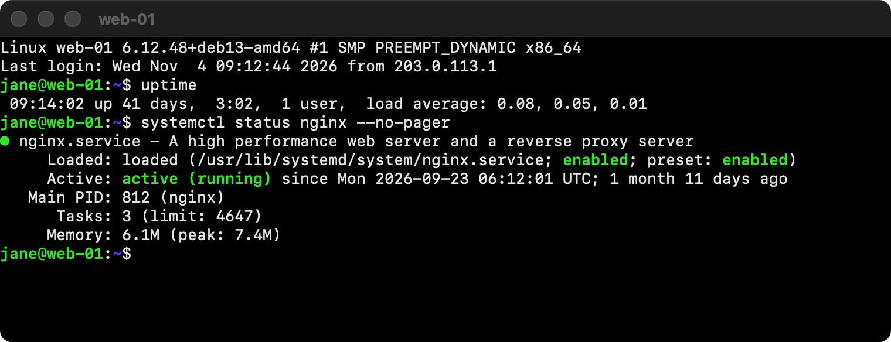

<p align="center"></p>

# iGateway.exe

A Remote Desktop and SSH client for the Mac. Windows servers behind an RD
Gateway or reached directly, and SSH to servers and switches, in one list,
with one Dock icon per server. It behaves like a Mac app.


## Remote Desktop

- **Gateways.** Servers are grouped per RD Gateway, each with its own
  account. Servers without one go under "Direct connections".
- **Feels like a Mac.** Resize the window or go fullscreen and Windows
  follows. Cmd-C and Cmd-V, the Mac's scroll direction and your keyboard
  layout just work.
- **Copy and paste** text, images and files, both ways. Sound, a shared
  folder, and H.264 video through macOS's own decoder.
- **Certificates you can check.** One that neither FreeRDP nor macOS can
  verify is shown to you before you log in.
- **Plain error messages.** A failed connection says which step went wrong:
  the gateway, the login, or the server.

## SSH



- **A terminal per server**, running the Mac's own ssh. Pick the font, size
  and text colour.
- **Jump hosts.** Fill in a host's jump host and it's grouped under it. The
  jump leg gets the same key and settings as the server behind it.
- **Keys.** File, Create SSH Key makes one and shows the public key to copy.
  A certificate next to a key is used by itself.
- **Passwords and passphrases** can be saved in the Keychain. They go to ssh
  through its own password helper, never through the terminal, so text a
  server prints can't catch them.
- **Locked down.** No agent or X11 forwarding, host keys are always checked,
  and a host with a key never falls back to a password. A server can't read
  or change your clipboard.

## Everywhere

- **A Dock icon per server.** Every session is its own app, with the
  server's label on its icon in a colour you pick.
- **Recent connections:** what you connected to, for how long, and why
  something failed.
- **Export and import** your server list, never passwords or accounts.

## Install

It runs on an Apple Silicon Mac with macOS 13 or later.

**Download:** the app is under
[Releases](https://github.com/FarAbove420/igateway/releases) as a zip. It
isn't signed by Apple, so macOS blocks it the first time you open it: allow
it under System Settings, Privacy & Security.

**Or build it yourself**, no Homebrew needed:

1. Install the Xcode Command Line Tools, if you don't have them yet. They
   bring git and the compilers, and need the macOS 14 SDK or later.

   ```bash
   xcode-select --install
   ```

2. Get the code.

   ```bash
   git clone https://github.com/FarAbove420/igateway.git
   cd igateway
   ```

3. Build and install it. The first time, this also downloads FreeRDP,
   OpenSSL and SwiftTerm, checks each against a pinned SHA-256 and
   builds them, which takes a few minutes.

   ```bash
   ./build.zsh --install
   ```

4. Open iGateway.exe from `~/Applications`, the Applications folder inside
   your home folder (not the main one).

### Update

Quit iGateway first, then in the `igateway` folder:

```bash
git pull && ./build.zsh --install
```

The libraries are only rebuilt when their versions changed.

## Your data

- Servers and settings: `~/Library/Application Support/iGateway/config.json`
- Passwords and key passphrases: your login Keychain, only when you choose
  to save them
- SSH keys: `~/.ssh`, the Mac's usual place (File, Open SSH Keys Folder)
- Logs: `~/Library/Logs/iGateway`, or Window, Show Logs. Never passwords.

To remove iGateway, delete the app, `~/Library/Application Support/iGateway`,
`~/Library/Logs/iGateway` and `~/Library/Caches/iGateway`. Saved passwords
are in Keychain Access under "iGateway.exe". Your SSH keys stay where they
are.

## Limits

- Remote Desktop logins use NTLM; Kerberos isn't supported.
- No smartcards, printers, microphone, USB devices or multiple monitors.
- SSH hosts can't go through an RD Gateway, which only carries Remote
  Desktop. Use a jump host instead.

## Built with

iGateway stands on the shoulders of these projects:

- [FreeRDP](https://github.com/FreeRDP/FreeRDP) for the Remote Desktop
  protocol (Apache 2.0)
- [OpenSSL](https://www.openssl.org) for TLS and the login cryptography
  (Apache 2.0)
- [SwiftTerm](https://github.com/migueldeicaza/SwiftTerm) for the terminal
  (MIT), which builds on [xterm.js](https://github.com/xtermjs/xterm.js)
  and has a part ported from [libsixel](https://github.com/saitoha/libsixel)
  (both MIT)
- [Unicode](https://www.unicode.org) data, for time zones and character
  widths (Unicode License V3)
- [OpenSSH](https://www.openssh.com), the ssh that comes with macOS
- [CMake](https://cmake.org), to build FreeRDP

The details and licence texts are in
[THIRD_PARTY_NOTICES.md](THIRD_PARTY_NOTICES.md), and in the app under
iGateway.exe, Acknowledgements.

## What's in here

- `swift/`: the app (host list, sessions, SSH terminal, clipboard, keyboard)
- `bridge/`: a small C layer between the app and FreeRDP
- `deps/build-deps.zsh`: downloads and builds the libraries;
  `deps/check-updates.sh` shows whether they have newer releases
- `build.zsh`: builds the app; `release.zsh`: packs it for a release
- `tests/`: the tests, run with `tests/run.zsh`; `tests/run.zsh --screenshots`
  renders the images in this README
- `icon/`: the app's artwork, and the code that puts it on Apple's icon grid
  and draws the session icon
- `docs/`: [how it works, and why](docs/how-it-works.md), and the images here
- `.github/workflows/`: builds and tests every push, attaches the app to
  every release, and checks every Monday for newer library releases

## License

Apache 2.0, see [LICENSE](LICENSE).
